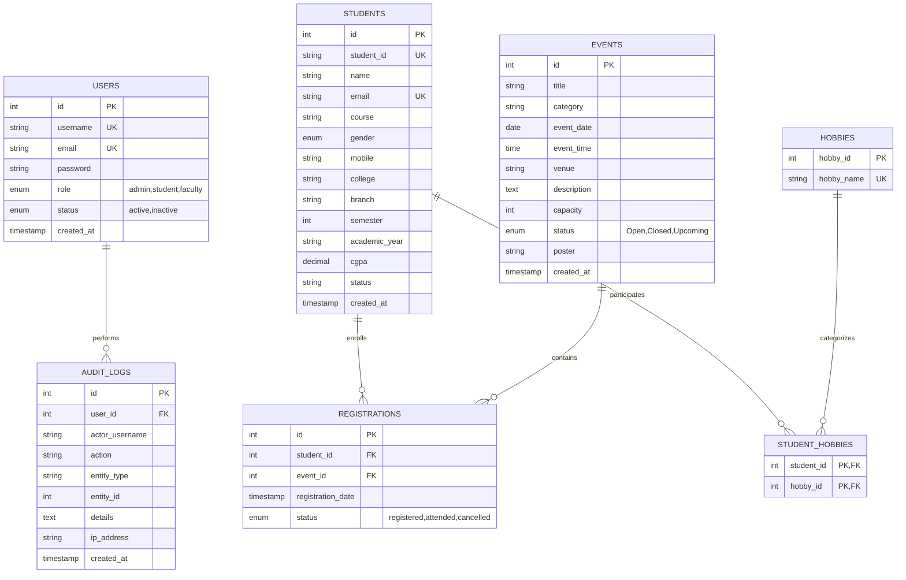

# Practical 8: MySQL Schema Design, ER Model, and Database Connectivity

## Academic Information
- **Course**: Web Development Frameworks (`ITUE203`)
- **Institution**: CHAROTAR UNIVERSITY OF SCIENCE AND TECHNOLOGY (CHARUSAT)
- **Faculty**: Faculty of Technology and Engineering (FTE) / CSPIT
- **Department**: Computer Engineering
- **Semester**: 3rd Semester, Academic Year 2026–27
- **Course Outcomes**: `CO1, CO5`

---

## 1. Aim / Objective
To design and implement a normalized relational database schema for the StudentHub web application, construct a documented Entity-Relationship (ER) model, configure secure PHP PDO connectivity with prepared statement emulation disabled, and provide a database health monitoring dashboard with complete seed verification.

---

## 2. Entity-Relationship (ER) Diagram



---

## 3. Database Normalization Analysis

1. **First Normal Form (1NF)**:
   - Each column contains atomic (indivisible) values. Multi-valued student hobbies were removed from a comma-separated list into the discrete lookup table `hobbies` and composite relationship table `student_hobbies`.
   - Every table possesses a defined Primary Key (`id`).
2. **Second Normal Form (2NF)**:
   - All non-key attributes are fully functionally dependent on the entire primary key (no partial dependencies on composite keys in `student_hobbies` or `registrations`).
3. **Third Normal Form (3NF)**:
   - No transitive dependencies exist (non-prime attributes do not depend on other non-prime attributes). For example, event details belong strictly in `events`, and student details in `students`. The link table `registrations` retains foreign key pointers only.

---

## 4. PDO Configuration & Security Features

The database connection in `db.php` enforces secure defaults:
- **`PDO::ATTR_ERRMODE => PDO::ERRMODE_EXCEPTION`**: Replaces silent SQL warnings with catchable exceptions.
- **`PDO::ATTR_DEFAULT_FETCH_MODE => PDO::FETCH_ASSOC`**: Protects against numerical array indexing overhead.
- **`PDO::ATTR_EMULATE_PREPARES => false`**: Instructs MySQL to use true server-side compiled prepared statements.
- **`charset=utf8mb4`**: Prevents multibyte SQL truncation attacks.
- **Decoupled Config**: Safe configuration template `config.example.php` excludes secrets from GitHub.

---

## 5. How to Import in XAMPP / phpMyAdmin

1. Open **XAMPP Control Panel** and start **Apache** and **MySQL**.
2. Open your browser and navigate to:
   ```
   http://localhost/phpmyadmin/
   ```
3. Click **"New"** in the left sidebar and enter the database name:
   ```
   studenthub
   ```
   Select collation `utf8mb4_unicode_ci` and click **Create**.
4. Click on the newly created `studenthub` database, navigate to the **"Import"** tab.
5. Click **"Choose File"**, select `database/studenthub.sql` (or `Practical 8/studenthub.sql`), and click **"Import"** at the bottom.
6. Open:
   ```
   http://localhost/StudentHub/Practical%208/
   ```
   The dashboard will report **CONNECTED** and display table inventories.

---

## 6. Verification Test Suite

| Test ID | Scenario Tested | Action / Query | Expected Output | Status |
|:---:|---|---|---|:---:|
| **TC-01** | PDO Connection | Open `Practical 8/index.php` | Connection card reports green *"CONNECTED"*, server version and UTF-8 charset. | **PASS** |
| **TC-02** | Schema Integrity | Count query on `students` table | Returns $\ge 20$ pre-seeded student records across CE, IT, AI, EC, ME. | **PASS** |
| **TC-03** | Users Seed | Count query on `users` table | Contains pre-seeded Admin, Student, and Faculty accounts with BCrypt hashes. | **PASS** |
| **TC-04** | Named Placeholders | In `prepared.php`, filter by Course | Returns filtered result set via `:course` parameter without string concatenation. | **PASS** |
| **TC-05** | SQL Injection Resistance | Pass input `' OR '1'='1` into `prepared.php` | Query treats payload as an inert literal string; returns 0 matches safely. | **PASS** |
| **TC-06** | Foreign Key Deletion | Delete test student | Registrations associated with student cascade-delete automatically (`ON DELETE CASCADE`). | **PASS** |

---

## 7. Viva Questions & Answers

**Q1: What are the main advantages of PDO over MySQLi in PHP?**  
*Answer:* PDO (PHP Data Objects) is an abstraction layer that supports 12 different database drivers (MySQL, PostgreSQL, SQLite, Oracle, etc.), uses consistent object-oriented syntax, supports named parameters (e.g. `:email`), and provides unified transaction management. MySQLi only works with MySQL databases.

**Q2: What is the purpose of `PDO::ATTR_EMULATE_PREPARES => false`?**  
*Answer:* By default, PDO emulates prepared statements by substituting variables into the query locally in PHP before transmission. Setting this to `false` forces PDO to use true, two-phase server-side prepared statements in the MySQL engine, maximizing SQL injection security.

**Q3: What is the difference between Primary Key and Unique Key?**  
*Answer:* A Primary Key uniquely identifies each row in a table and cannot contain `NULL` values; each table may have only one primary key. A Unique Key enforces column uniqueness but allows one or more `NULL` values depending on database constraints; a table may have multiple unique keys.

**Q4: Explain the importance of Foreign Key constraints with `ON DELETE CASCADE`.**  
*Answer:* A Foreign Key establishes a parent-child relationship between tables, preserving referential integrity. With `ON DELETE CASCADE`, when a parent row is deleted (such as a student or event), all dependent child records in the registration table are deleted automatically, preventing orphaned records.

**Q5: Why must database configuration credentials be separated from version control?**  
*Answer:* Committing database passwords to public or shared Git repositories exposes databases to automated crawlers and credential stuffing attacks. Storing credentials in local configuration files (`config.php`) ignored via `.gitignore`, while providing a sanitized `config.example.php`, prevents credential leakage.
